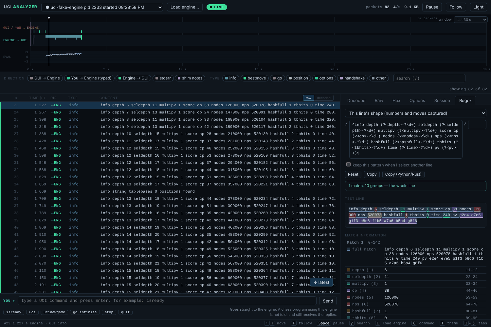
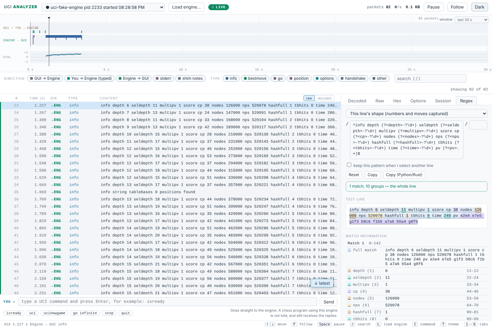

# UCI Analyzer

Shows the conversation between a chess program and a chess engine as it happens,
like a protocol analyzer. Written in Rust with no third-party dependencies.



```
 chess program (Arena, Fritz, Lucas Chess, ...)
        │  starts "the engine"
        ▼
   uci-shim.exe ──────────────►  the real engine (stockfish.exe, ...)
        │   passes every line through unchanged, both ways
        │
        └── a small local server on 127.0.0.1
                    │
                    ▼
             uci-viewer.exe  ──►  analyzer window (timeline, packets, decoded view)
```

- **uci-shim** sits in the engine's place. The chess program talks to it as if it
  were the engine; it starts the real engine and passes everything through
  untouched. It also saves a transcript and lets the viewer watch live.
- **uci-viewer** opens a window that shows the traffic live: a timeline
  ("scope") of who said what and when, a packet list you can filter and
  search, and for the selected packet a decoded view, the raw line and a hex dump.
  It also lists the engine's options and which ones the program changed.

Nothing leaves your computer: both programs only listen on `127.0.0.1`.

## Build and test (Windows, PowerShell or cmd)

```
cd uci-analyzer
cargo test
cargo build --release
```

Programs land in `target\release\`. There are no third-party dependencies, so
nothing is downloaded except Rust itself.

## Open the analyzer

Double-click **`try-it.bat`** (it builds, then opens the analyzer window), or run:

```
target\release\uci-viewer.exe
```

Nothing is started for you. Press **Load engine...** in the window to start an
engine of your own (next section), or point a chess program at the shim
(the section after). Close the console window to stop the viewer and any engine
you loaded from it.

Just want to see the window with some traffic first? **`demo.bat`** (or
`target\release\uci-demo.exe`) plays two pretend sessions with a made-up
engine. It is optional and never runs unless you start it.

## Load an engine from the viewer

1. Press **Load engine...** (or `L`).
2. Paste the engine's path (quotes from Explorer's "Copy as path" are fine) or
   press **Browse...**, add arguments if the engine needs any, and press **Load**.
3. The session opens by itself and the viewer sends `uci` for you, so the
   engine's name and options appear. From then on you are the chess program:
   type commands in the box under the packet list (`isready`, `position ...`,
   `go infinite`, `stop`, `quit`).

Engines you loaded before are listed in the dialog (double-click to load again).
`quit` ends that engine; closing the viewer stops it too. Start the viewer with
`--no-launch` if you do not want it to be able to start programs at all.

## Use it with a chess program (for example Arena)

1. Make a folder for the pair, for example `C:\Engines\stockfish-shim\`.
2. Copy `uci-shim.exe` there. You may rename it (`stockfish-shim.exe`).
3. Copy `uci-shim.cfg.example` next to it, rename it to match the exe
   (`uci-shim.cfg`, or `stockfish-shim.cfg`), and set `engine=` to the real
   engine's full path.
4. In the chess program, add the shim exe as a new **UCI engine** (Arena:
   Engines > Install New Engine).
5. Start `uci-viewer.exe` (it opens its own window). Then use the engine as
   normal in the chess program: the traffic shows up live. When the program
   starts a new engine process (for example for the next game), the viewer
   switches to the new session by itself.

If the config is missing or the engine cannot start, the shim still answers
`uci` with an `info string` that says why, so the chess program shows the
problem instead of timing out.

## The viewer window

| Part | What it does |
| --- | --- |
| Load engine (top) | Opens the dialog described above. |
| Session list (top) | Running sessions, and saved transcripts from earlier. Pick one to look at it. |
| Timeline | Top lane: what the program sent. Middle lane: what the engine sent. Bottom: the engine's evaluation. Hover for a packet, click to select it. Choose how much time it covers at the top right. |
| Filters | Turn directions and message types on and off; search the raw text (`/`). The `info` lines are the bulk of the traffic, so switching them off is often the first thing to do. |
| Packet list | One row per line. `raw` shows it exactly as sent, `decoded` shows a plain-English reading. |
| Detail panel | Decoded fields, raw line, hex dump, the engine's options (declared and changed), and a session summary with a link to the transcript. |
| Command box (bottom) | Type a UCI command and press Enter to send it straight to the engine (`isready`, `setoption name Hash value 512`, `go infinite`, ...). `↑` `↓` recall earlier commands, the buttons send common ones, and the box suggests commands as you type. It shows in the list as a `YOU→` row. |
| Theme button (top right) | Switches between dark and light. The choice is remembered. |
| Regex tab | Click a line, open the Regex tab (`6`) and it offers regular expressions that match that line: a general one for its message type, one for this line's exact shape (numbers and moves captured as named groups), one per field (`depth`, `score cp`, `pv`, ...), and the line itself. Edit the pattern and the matches are highlighted in the line, each group in its own colour, with a table of what every group caught and a plain-English explanation of each part, as on regex101. It also counts how many lines of the session match, and **Show only these lines in the list** filters the packet list by the pattern (the `regex filter ✕` tag next to the search box turns it off). Tick **keep this pattern** to click through other lines and see which ones it matches. **Copy (Python/Rust)** writes named groups as `(?P<name>...)`. |
| Pause / Follow | Pause freezes the screen while recording continues. Follow keeps the newest packet in view; scrolling up turns it off. |

Keys: `↑` `↓` move, `F` follow, `Space` pause, `/` search, `L` load an engine,
`C` go to the command box, `T` switch theme, `1`–`6` switch tabs, `Home` / `End` jump.

**About typing commands.** The chess program does not know you typed them, and
the engine's answers still go to the chess program as well as the viewer. A
stray `go` or `position` can therefore confuse a game in progress; `quit` asks
for confirmation first. It works only while the session is running. To make the
viewer strictly read-only, start the shim with `--no-input` or put `input=off`
in its cfg.

Options: `uci-viewer --port 7878` (default; the next free port is used if taken),
`--no-open` (just print the address; then open it in any browser),
`--no-launch` (no Load engine button; the viewer cannot start programs),
`--browser default` (a tab in your normal browser instead of an app window).

## Config and settings

`uci-shim.cfg` (see `uci-shim.cfg.example`) holds `engine`, `args`, `log_dir`,
`log`, `viewer`, `input`, `viewer_port`, `eof_grace_ms`. Command-line flags of the shim
(`--engine`, `--log-dir`, `--no-log`, `--no-viewer`, `--no-input`, ...) win over the file.

Files live in `%LOCALAPPDATA%\uci-visualizer\` (set `UCI_VISUALIZER_HOME` to move
it): `transcripts\` (one `.jsonl` per session) and `sessions\` (one small file
per running shim, so the viewer can find it).

## Transcript format

JSON Lines, one event per line:

```
{"t":12,"dir":"gui>engine","line":"isready"}
```

`t` is milliseconds since the shim started. `dir` is `gui>engine`, `engine>gui`,
`engine>stderr`, `viewer>engine` (typed in the viewer's command box) or `shim`
(notes from the shim itself: start, config, exit code).
Unknown keys are ignored by readers.

## What is in the workspace

| Crate | What it is |
| --- | --- |
| `uci-core` | UCI parser, plain-English descriptions, transcript format, JSON helpers. No dependencies. |
| `uci-shim` | `uci-shim.exe`, the pass-through wrapper and live server. Also builds helper programs: `uci-demo` (the demo above), `uci-fake-engine` (scripted pretend engine) and `uci-latency` (timing check). |
| `uci-viewer` | `uci-viewer.exe`, the analyzer window. |
| `uci-replay` | `uci-replay.exe`: prints a saved transcript in the console. Optional. |

## Known gaps

- Built and tested on Linux so far. The Windows-only pieces have not been run
  yet: hidden engine window, opening the app window with Edge, the console
  colours in `uci-replay`. Run `try-it.bat` first; if the window does not open,
  start `uci-viewer --browser default` instead, and please open an issue describing what you see.
- The Regex tab uses the browser's own regular-expression engine (JavaScript syntax). A pattern that backtracks badly can make the page stall while it counts lines; close the tab or edit the pattern to recover.
- Loading an engine and typing commands have only been tested against the made-up engine on Linux. The Browse... button and hiding the engine's window are Windows-only code that has not been run yet; if Browse does nothing, paste the path.
- Fritz has not been tried; it may start external engines differently.
- A viewer that joins a session late is caught up with the last 200,000 packets.
  The full record is always in the transcript file.

## Light theme



## License

MIT. See [LICENSE](LICENSE).
